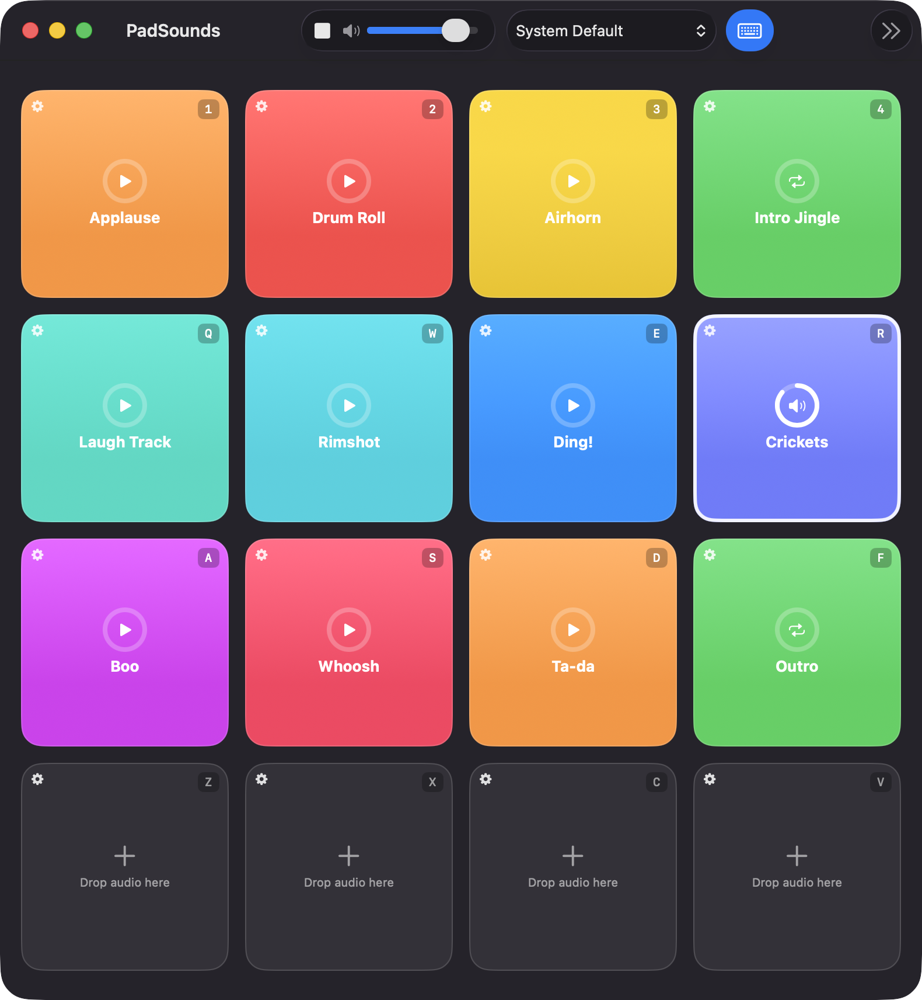
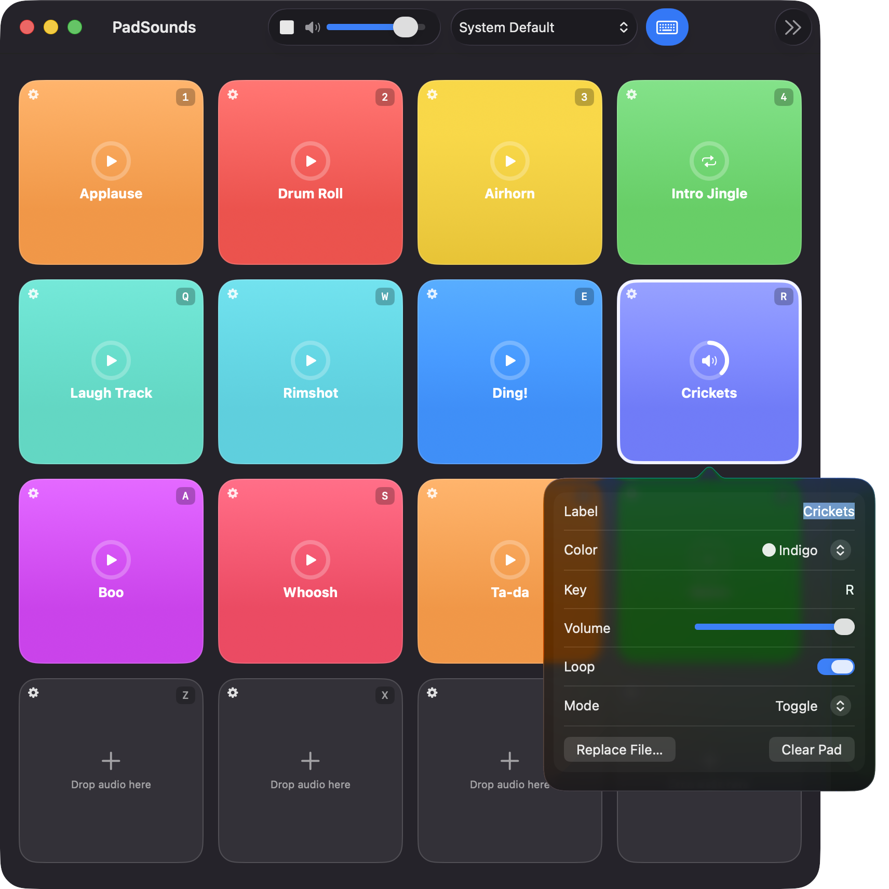
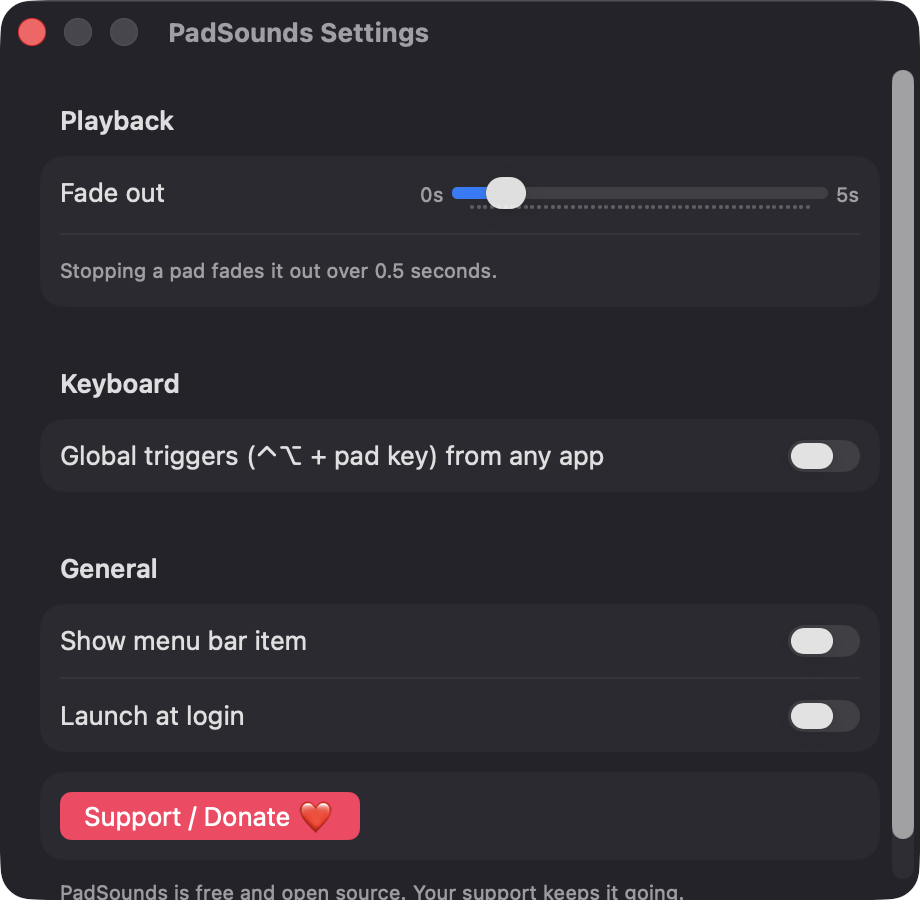

# PadSounds

**🌐 Website:** [turhe123.github.io/pad-sounds](https://turhe123.github.io/pad-sounds/)

A grid of sound pads you trigger by click or keyboard key, for streams, podcasts, classes and jokes.

> 🆓 A free, open-source **Jingle Box alternative** for macOS 14+. Native Swift, no accounts, no subscriptions, MIT licensed.


## Why

PadSounds is a free, open-source, 100% native, backend-free alternative to paid utilities in the *Audio* category. It was inspired by Jingle Box ($19.99 one-time), and keeps to a simple core: a pad grid, hotkeys and per-pad playback controls. There is no account, no server and no network access. Your board and sounds stay on your Mac.

## Features

- **4×4 grid of 16 pads**, each with a label, a color (11-color palette), an imported audio file, volume, loop toggle, play mode and a single assigned key.
- **Three play modes:** Play Once (pressing a playing pad restarts it), Hold to Play (stops on key up) and Toggle.
- **Drag and drop** an audio file onto a pad, or use *Choose File… / Replace File…* in the pad inspector. Right-click a pad or click its gear to open the inspector.
- **Keyboard triggering** with default keys `1 2 3 4 / Q W E R / A S D F / Z X C V` while the window is focused. Duplicate keys are rejected with a message, and typing in a text field (such as the label editor) never fires pads.
- **Optional global triggers:** ⌃⌥ + a pad's key works while another app is in front.
- **Stop All** button and the **Esc** shortcut, with a configurable **fade-out** (0–5 s).
- **Master volume** and an **output device picker** for the whole board. If the chosen device disappears, PadSounds falls back to the system default and tells you.
- **Progress ring** on each pad while it plays.
- **Imported files are copied** into Application Support, so pads keep working if the originals move. Large files are streamed instead of loaded into memory.
- **Autosave:** the board is stored as JSON in `~/Library/Application Support/PadSounds/`.
- A pad with a missing or unreadable file shows a red warning badge and a toast.
- Optional **menu bar item** and **launch at login** (in Settings).
- Built on AVAudioEngine with SwiftUI and AppKit. No third-party dependencies.

## Screenshots

<p align="center"></p>

<p align="center"><em>The 4×4 pad grid with colored, labeled pads, each showing its trigger key the looping Crickets pad is playing and shows its progress ring.</em></p>

<p align="center"></p>

<p align="center"><em>The pad inspector lets you set a pad&#x27;s label, color, key, volume, loop and play mode, or replace or clear its audio file.</em></p>

<p align="center"></p>

<p align="center"><em>Settings for fade-out time, global ⌃⌥ triggers, the menu bar item and launch at login, plus the Support / Donate button.</em></p>

## Install

1. Download `PadSounds-macOS.zip` from the [latest release](https://github.com/turhe123/pad-sounds/releases/latest).
2. Unzip it and move `PadSounds.app` to `/Applications`.
3. The app is open source and not notarized, so macOS will block it at first. Remove the quarantine flag:

   ```bash
   xattr -cr /Applications/PadSounds.app
   ```

4. The first time, right-click the app and choose **Open**.

Requires macOS 14 (Sonoma) or later.

## Build from source

You need Xcode with the macOS 14 SDK or later.

```bash
brew install xcodegen
xcodegen generate
xcodebuild -project PadSounds.xcodeproj -scheme PadSounds -configuration Release -derivedDataPath ./build build
```

The app is produced at `build/Build/Products/Release/PadSounds.app`.

## Permissions

PadSounds asks for very little:

- **Accessibility** (optional): only needed if you turn on *Global triggers* in Settings. macOS requires it for an app to observe key presses while another app is focused. PadSounds explains this before showing the system prompt, only looks for its own pad keys, and never records or sends your typing anywhere. Without it, keys still work whenever the PadSounds window is focused.
- **File access:** only the audio files you pick or drop, which are copied into the app's Application Support folder.

PadSounds plays audio only. It does not request Screen Recording or Microphone access.

## Support ❤️

PadSounds is free and always will be. If it's useful to you, you can support its development:

[Support Or (Leo) Davidai ❤️](https://ko-fi.com/leodavidai)

The app also has a **Support / Donate ❤️** button in the toolbar, the Help menu and Settings.

## More free Mac apps

PadSounds is one of [60 free, open-source Mac utilities](https://github.com/turhe123/mac-apps) built the same way: native Swift, no accounts, no telemetry. Browse the full gallery at [turhe123.github.io/mac-apps](https://turhe123.github.io/mac-apps/).

## License

MIT © Or Davidai Bachar
